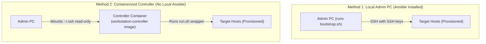

# Remote deployment



## From an admin PC (Ansible installed)

Add target hosts to `ansible/inventory/hosts.yml`, then run:

```bash
ansible-playbook ansible/site.yml -K -l my_laptop
```

## From a controller container (no Ansible on admin PC)

Build and run the containerised Ansible controller — works with Podman or
Docker:

```bash
# Run site.yml against all hosts
./controller/run.sh

# Limit to a single host
./controller/run.sh -l my_laptop

# Limit to servers, prompt for become password
./controller/run.sh -l servers -K
```

The container mounts `~/.ssh` read-only so your SSH keys are available without
embedding them in the image.

## WSL2 LAN SSH access (Windows host + WSL2)

To allow teammates on the local network to SSH into both a Windows host (port `22`) and a WSL2 instance (port `2222`):

1. **Inside WSL2** — For Ansible-provisioned `wsl_instances`, the `ssh` role configures `/etc/ssh/sshd_config.d/50-wsl-lan.conf` on port `2222` automatically (`wsl2_ssh_enabled: true`). For standalone WSL2 distros without Ansible, run:
   ```bash
   ./scripts/setup-wsl-ssh.sh
   ```
2. **On Windows (elevated PowerShell)** — Install/enable Windows OpenSSH Server, configure firewall rules, and forward port `2222` to the WSL2 instance IP:
   ```powershell
   .\scripts\setup-windows-ssh.ps1
   # Or target a specific named WSL2 instance:
   .\scripts\setup-windows-ssh.ps1 -WslDistro wsl-fpga-dev
   ```
   Re-run `setup-windows-ssh.ps1` after a Windows reboot or `wsl --shutdown` if WSL2's internal IP changes (skipped automatically in WSL mirrored networking mode).
